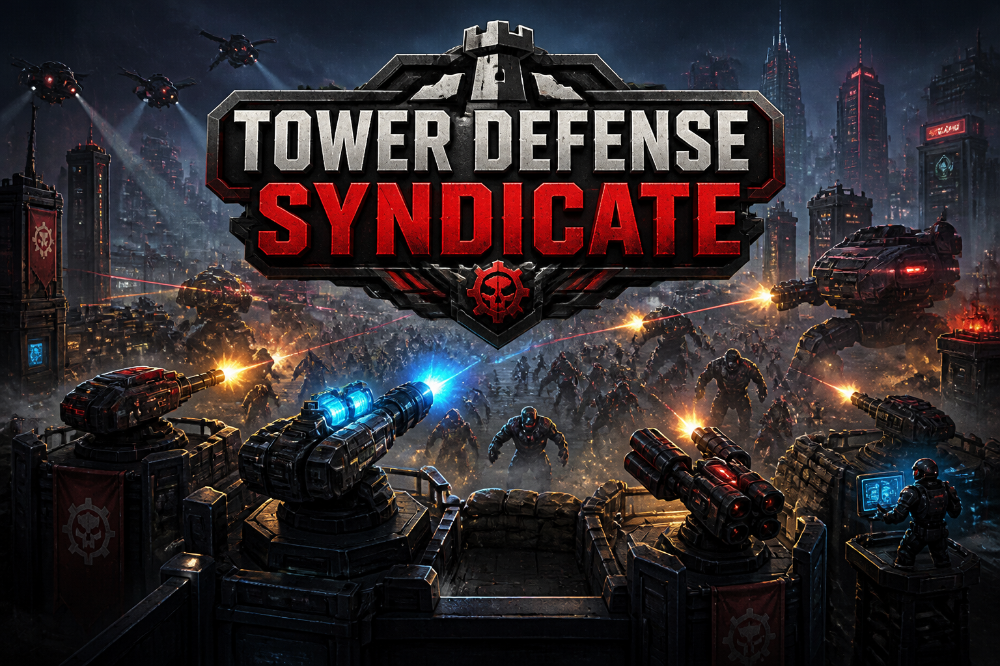

# Tower Defense Syndicate

Индастриал tower defense: завод работает, даже когда ты спишь. Буры роют железо, кремний, уран и
плазму, ASIC-стойки псевдо-майнят SEC — внутреннюю валюту синдиката без вывода в рубли, — лабиринт
обороны расставляешь сам, а рейды приходят асинхронно и по рейтингу. Клан — это общая казна.

Копай. Добывай. Держи осаду.



Проект делается под ВКонтакте (мини-приложение), но ядро от площадки не зависит: весь баланс,
экономика и разрешение боёв живут на сервере, а касания ВК-API изолированы в тонких обёртках —
четыре на фронте (`VkAuthManager`, `VkAdsManager`, `VkPaymentManager`, `VkSocialManager`) и
несколько на сервере (`vk.push`, `vk.adapter`, `vk.signature`, `vk.telemetry`, `provider.vk`).

## Статус

Готово и покрыто тестами: экономика (энергия, склады, офлайн-накопление до 72 часов), сооружения
и крафт, переработка хлама, материалы, добыча бурами, мощность и ASIC, PvP-рейды с реплеями и
правилом «защитник не теряет постройки», рейтинг от бронзы до алмаза, кланы с казной, чёрный и
цветной рынки с экономикой цен, журнал (ledger), заметки и пуши, «пригласи друга» (привязка при
регистрации, суточный потолок, запрет самоприглашения), rewarded-реклама и заказы VK Pay
на уровне серверных контрактов.

Не готово — и это видно в коде, а не только в README:

- **Деплой.** Публичного HTTPS-адреса нет, конфигурация рассчитана на локальный стенд.
- **Вход подключён и к витрине, и к боевому клиенту — но живым WebView не проверен.** `play.html`
  читает `initData` через VK Bridge и зовёт боевой `POST /v1/auth/vk/init-data`, когда
  `GET /v1/config` ответил `auth.mode=vk`; без координат площадки страница переключается на
  отладочный `dev-login`, а при выключенном `DEV_SIGNER_ENABLED` — говорит, что вход отключён, а
  не молча ловит 403. Тот же путь теперь есть и во фронте: `frontend/src/vk/VkAuthManager.ts`
  (режим — у сервера, `initData` — из моста с фолбэком на URL, повтор при `EXPIRED_INIT_DATA`,
  JWT в хранилище, `initData` не сохраняется). Режим выбирает сервер
  (`config/env.ts:authModeOf`), а не догадка фронтенда. Проверить локально можно без клиента ВК:
  `POST /v1/dev/vk/sign` подписывает initData тем же кодом, которым её проверяют
  (`npm run vk:doctor`, `node server/scripts/smoke.mjs`). Что остаётся непроверенным до первого
  реального входа: имя поля подписи (`sign`/`sig`), формы байтов (сырые/раскрытые), участие
  `hash` в строке проверки и имя поля времени (`ts`/`vk_ts`) — все варианты принимаются, а
  фактический виден в `GET /health` (`vk_auth.lastAccepted`) и в логе `auth_vk`.
- **Монетизация выключена.** `ADS_ENABLED=false`, `PAYMENTS_ENABLED=false` — включаются только
  после настройки серверного postback, иначе реклама и товар выдаются по просьбе клиента.
  Повторную доставку рекламного постбэка гасит память исполненных `reward_id` в документе игрока
  (`ADS_REPLAY_WINDOW_SEC`); она бесполезна лишь в том случае, если площадка шлёт постбэк совсем
  без `reward_id`, — это и выясняется первым живым постбэком по полю `correlated` в логе.
- **Иконка и скриншоты карточки.** Есть только ключ-арт 1536×1024, каталог требует 512×512.

## Быстрый старт

Нужен Node ≥ 20.11.

```bash
npm install
copy .env.example .env   # Windows; иначе cp -b
npm run dev              # tsx watch, http://127.0.0.1:3000
```

Два стенда, оба без сборки — HTML лежит рядом с маршрутом и отдаётся как есть:

| Адрес | Что |
|---|---|
| `/` и `/debug` | отладочный полигон: конфиг, кошелёк, маршруты в один клик |
| `/play` | витрина игры: планировка, оборона, рейд, цех, рынок, клан |

`STORE_DRIVER=memory` в примере конфига — MongoDB не нужна, состояние живёт в процессе.

## Команды

| Команда | Что делает |
|---|---|
| `npm run dev` | сервер в watch-режиме |
| `npm run build` | `tsc` сервера в `dist/` |
| `npm test` | весь набор vitest (часть случаев поднимает реальный mongod) |
| `npm run typecheck` | сервер **и** фронтенд (`frontend/tsconfig.json`) |
| `npm run copy:check` | счётчик копирайта: длины строк карточки, дрейф с кодом, стоп-лист, термины |
| `npm run copy:negtest` | доказывает, что предыдущая проверка краснеет на возвращённый брак |
| `npm run vk:doctor` | круговые подписи прод-кода: `initData`, событие площадки, рекламный постбэк; с аргументом — разбор живой строки запуска: форма подписи, перебор проходов, реферал |
| `npm run audit:energy` | прогон журнала энергии от рождения аккаунта: находит переплату над честным потолком и по `--apply` возвращает её списанием с записью в журнал |
| `node server/scripts/smoke.mjs` | смоук живого стенда: боевой вход по initData (обе формы `hash`), реферал и его догон, экономика, PvP, клан, рынок, долг |

## Архитектура

```text
server/src/
  config/       баланс как данные: structures, materials, market, pvp, clans, shop, ads, limits
  modules/      домен: economy, workshop, materials, pvp, raid, market, clan, ledger,
                notification, payment, social, auth, user
  http/         Fastify: app.ts (маршруты, /health, стенды), auth.ts, routes/*.ts
  lib/          errors, logger, rng, scheduler
frontend/src/vk/  тонкие обёртки площадки: VkAuthManager, VkAdsManager, VkPaymentManager, VkSocialManager
```

Три инварианта, на которых всё это держится:

1. **Клиент не хранит ни одной копии констант баланса.** Стенды берут геометрию из `/v1/config`,
   боевые цифры — из ответа рейда. Из-за этого `play.html` и `debug.html` не нуждаются в сборке
   и не могут разойтись с сервером.
2. **Разрешает сервер.** Рейд, крафт, рынок и начисление лута резолвятся на сервере; клиент
   показывает результат. Анти-фарм (суточные лимиты, потолки, TTL незакрытых сессий) — тоже там.
3. **Деньги и награда подтверждаются площадкой, а не просьбой.** Заказ товара и награда за
   рекламу выдаются по серверному postback; пока он не настроен, обе ручки выключены. У рекламы
   одноразовость держится ещё и памятью исполненных `reward_id` площадки: слот показа после выдачи
   пуст, и без этой памяти сетевой ретрай оплачивал бы следующий показ игрока.

Хранилище — два драйвера за одним интерфейсом (`*.store.ts` / `*.mongo.ts`): `memory` для
разработки и тестов, `mongo` для продакшена. Журнал операций (`ledger`) — источник истины по
всем движениям ценностей.

## Охраны, а не декларации

Проект защищён проверяемыми утверждениями, а не комментариями «так надо»:

- `server/test/meta.suites.test.ts` — следит, чтобы каждый тестовый файл реально попадал в прогон
  (он появился после того, как шесть клановых тестов молча не выполнялись);
- `npm run copy:check` — строки карточки ВК обязаны дословно совпадать с кодом, а обещания
  вне реализации не проходят стоп-лист;
- `npm run copy:negtest` — сами проверки проверяются негативно: снятый брак обязан их валить.

Подробнее про копирайт карточки и про то, как он расходился с кодом, — `VK_CATALOG.md`.

## Что не публикуется

Директория `private/` в `.gitignore`: техзадание, сырые растры под кабинет ВК, координаты
конкретного приложения и bundle с историей. Коэффициенты баланса, потолки и лимиты при этом
**публикуются полностью** — они лежат в `server/src/config/*.ts` и являются частью кода, а не
тайны: без них невозможно ни проверить экономику, ни запустить проект.

## Лицензия

MIT — полный текст в [LICENSE](LICENSE). Использование, изменение и распространение разрешены,
включая коммерческие, при сохранении уведомления об авторском праве; ПО поставляется без
каких-либо гарантий.
